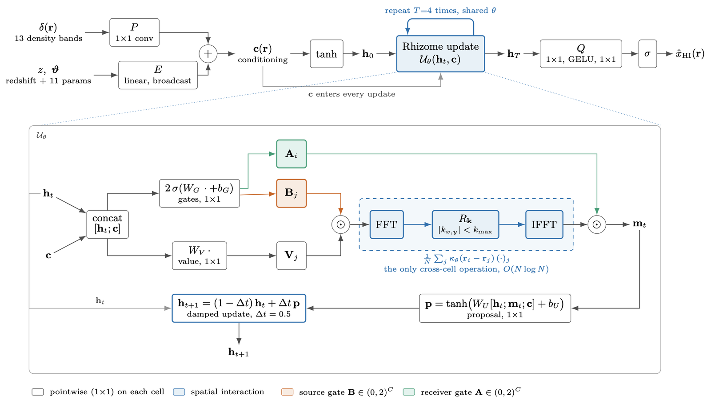
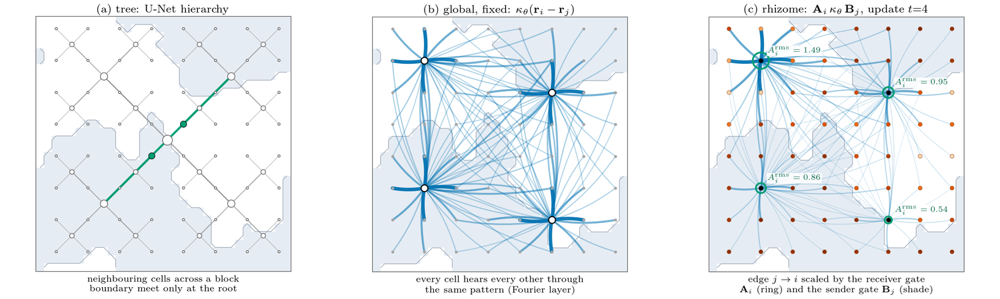
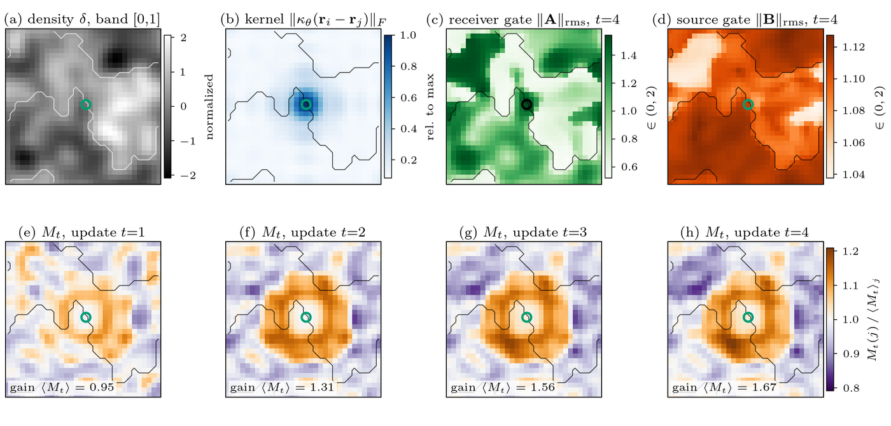
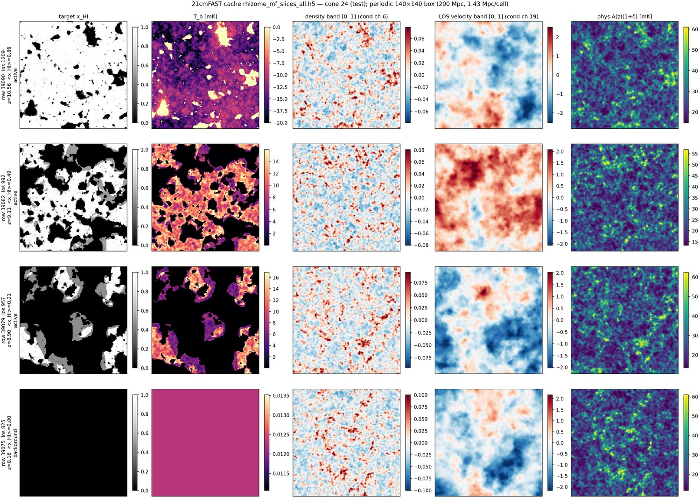
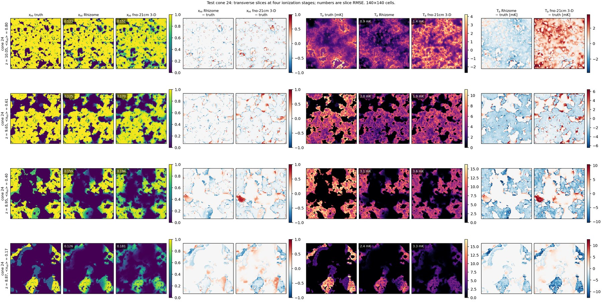
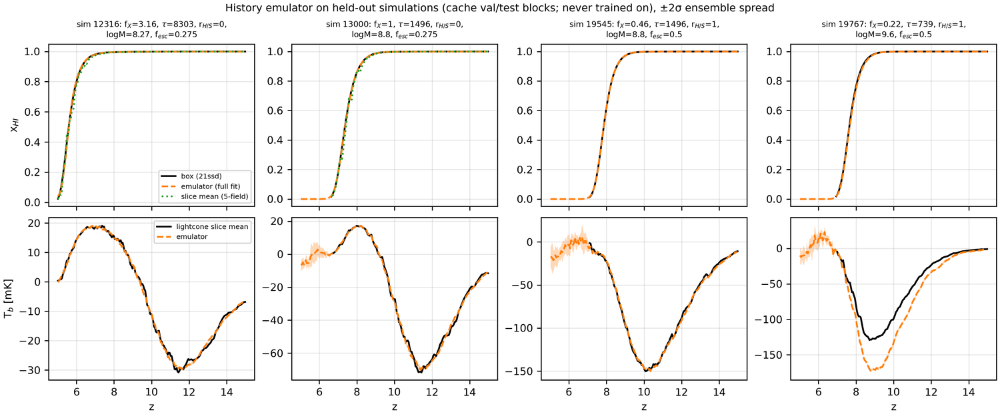
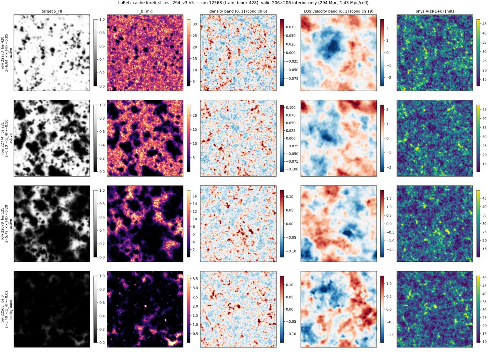
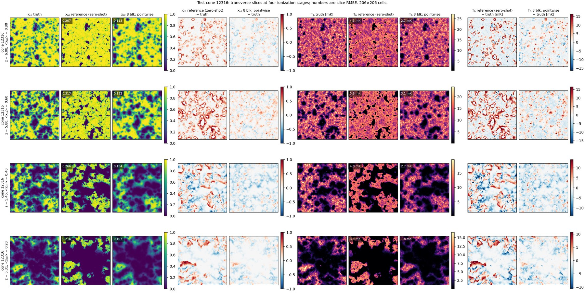

# Rhizome Neural Operator

A neural operator for 21-cm reionization lightcones. It predicts the neutral fraction
x<sub>HI</sub> and the brightness temperature T<sub>b</sub> on one transverse slice of a lightcone. Its
inputs are the matter density and line-of-sight velocity around that slice, the redshift,
and the global history the slice sits in. Slices are predicted independently and restacked
into full cones. The model is trained on 21cmFAST and transferred to the radiative-transfer
simulations of [LoReLi II](https://arxiv.org/abs/2411.03093).

The defining piece is the **rhizome update**. The only interaction between cells is a
learned translation-invariant kernel. That kernel is re-weighted, cell by cell and at every
update, by gates that read the current state.

<p align="center">
  
</p>

The Python package is called `ebm21cm` for historical reasons. The repository started as an
energy-based generative model, and that code is still here (see [Other code](#other-code)).

**Contents:**
- [The model](#the-model)
- [The 21cmFAST reference model](#the-21cmfast-reference-model)
- [Transfer to LoReLi II](#transfer-to-loreli-ii)
- [Evaluation and figures](#evaluation-and-figures)
- [Repository layout](#repository-layout)
- [Cluster](#cluster)
- [Tests](#tests)
- [Documentation](#documentation)

## The model

`ebm21cm.model.rhizome.RhizomeOperator2d`, in pseudocode:

```text
c   = lift(LOS density / velocity bands) + embed(scalars)        # pointwise
h_0 = tanh(c)
repeat T times with shared weights:                              # one synchronous update U_θ
    A, B  = 2·sigmoid(W_G [h_t; c])            receiver and source gates, channel-wise, in (0, 2)
    V     = W_V [h_t; c]                       value
    m_i   = A_i ⊙ (1/N) Σ_j κ_θ(r_i − r_j) (B_j ⊙ V_j)     # FFT with retained modes R_k
    p     = tanh(W_U [h_t; m_t; c])            proposal
    h_t+1 = (1 − Δt) h_t + Δt p                damped update, Δt = 0.5
x_HI = sigmoid(decode(h_T)),   T_b = x_HI · phys · (1 − exp(u))   # structured T_b head
```

- **One cross-cell operation.** The message m is the only operation that couples cells.
  - The kernel κ<sub>θ</sub> is parameterized by its Fourier coefficients and evaluated with an
    FFT, at O(N log N) with no N×N edge tensor.
  - Everything else is a 1×1 map.
- **Gated connections.** A Fourier layer connects every cell to every other through one fixed
  pattern. In the rhizome, the edge j → i is scaled by the receiver's gate A<sub>i</sub> and the
  sender's gate B<sub>j</sub>. Both gates are recomputed from the state at each update, so the
  effective connectivity changes as the field evolves (below: tree vs fixed global kernel vs
  rhizome).
- **Structured T<sub>b</sub> head.** The second output channel is a spin variable u, and
  T<sub>b</sub> = x<sub>HI</sub> · A(z)(1+δ) · (1 − e<sup>u</sup>). The physical factor
  `phys` = A(z)(1+δ) is an input, so the network only learns the spin-temperature part.
- **Periodic transverse domain.** The FFT treats the transverse plane as periodic, which
  matches 21cmFAST boxes. For non-periodic data (LoReLi lightcones) the plane is mirror-padded
  and only the interior is scored.

<p align="center">
  
</p>

Below, the learned kernel and gates of a checkpoint trained on toy lightcones, on a validation slice. The ring
is the receiver cell on an ionization front. Panels (e–h) show how the gates re-weight its
incoming connections over four updates:

<p align="center">
  
</p>

The equations, operator assumptions and the toy comparison with the additive local + Fourier
baseline `RecurrentFNO2d` are in [docs/rhizome_operator.md](docs/rhizome_operator.md). The
figures, their captions and what they do and do not show are in
[docs/figures/README.md](docs/figures/README.md).

The same law exists in other forms:
- in 3-D on lightcone windows (`ebm21cm.model.rhizome3d`, non-periodic LOS);
- with a compact real-space disc kernel (`radius=`);
- with several gated pathways ([docs/rhizome_multipath.md](docs/rhizome_multipath.md)).

## The 21cmFAST reference model

`runs/rhizome_mf2d_w64_structured_all` is the slice-wise multi-field model that every LoReLi
experiment starts from.

| | |
|---|---|
| conditioning | 26 channels: δ and the linear LOS velocity, each averaged over 13 LOS bands around the target slice (single cells within ±3, then [4,8), [8,16), [16,32) cells on each side; 1.4286 Mpc cells) |
| scalars | 38: 1/(1+z), the 11 21cmFAST parameters, and the global x<sub>HI</sub> and T<sub>b</sub>/100 histories averaged over the same 13 bands. The histories come from parameter emulators, never from the cone itself |
| physical factor | `phys` = A(z)(1+δ) in mK, for the structured T<sub>b</sub> head |
| outputs | x<sub>HI</sub> (sigmoid) and T<sub>b</sub> |
| grid | 140 × 140 periodic, 200 Mpc |
| architecture | width 64, 24 Fourier modes, 6 updates, Δt = 0.5; 18.5 M parameters |
| data | 6,567 21cmFAST cones (fno-21cm's multi-field split and normalization), 16 stratified + 2 background slices per cone (104,718 rows), z ≈ 5–25 |
| objective | BCE(x<sub>HI</sub>) + MSE(normalized T<sub>b</sub>); Adam, learning rate halved on validation plateaus, stop at the floor (84k steps) |
| test (cache rows) | x<sub>HI</sub> RMSE 0.087, T<sub>b</sub> RMSE 7.7 mK, BCE 0.132 on the stratified test slices |

Build the slice cache from fno-21cm's preparation, then train and export:

```bash
python -m ebm21cm.data.mf_all_prep --out $WORK/data/compressed/preparation_mf_all_raw.json

# one shard per array task (CLEAN_TB=1: fno-21cm's T_b cleaning on the raw files), then merge
export PREPARATION=$WORK/data/compressed/preparation_mf_all_raw.json CLEAN_TB=1 \
       SLICES_PER_CONE=16 BACKGROUND_SLICES=2 \
       SHARD_DIR=$WORK/data/compressed/rhizome_mf_slices_all_shards \
       CACHE=$WORK/data/compressed/rhizome_mf_slices_all.h5
AID=$(sbatch --parsable --export=ALL slurm/build_mf_slices.sbatch)
sbatch --dependency=afterok:$AID --export=ALL,MODE=merge slurm/build_mf_slices.sbatch

ARGS="--width 64 --batch-size 32 --head structured" \
    sbatch --export=ALL,RUN_DIR=runs/rhizome_mf2d_w64_structured_all slurm/train_rhizome_mf2d.sbatch

# restack slices into cones on fno-21cm's eval grid (+ native cylindrical power)
python -m ebm21cm.export_slicewise_mf --run runs/rhizome_mf2d_w64_structured_all \
    --reference $CUBES/rhizome3d_mf_C/manifest.json --tag rhizome2d_mf_w64_all --out-dir $CUBES
```

A test cone as the model sees it (target x<sub>HI</sub>, T<sub>b</sub>, the central density and
LOS-velocity bands, `phys`), at three stages and one background slice:

<p align="center">
  
</p>

**Results** on the 199 test cones, full restacked cones on fno-21cm's 512-plane evaluation grid,
scored with [21cmEVAL](https://github.com/thekaharis/21cmEVAL). The comparison is fno-21cm's 3-D
multi-field model `mf_cnn_whno_es_tbs_histtb_tbclean_ep26` (CNN + Walsh–Hadamard local operator),
which sees whole lightcone windows rather than one slice:

| model | x<sub>HI</sub> RMSE | T<sub>b</sub> RMSE [mK] | IoU | r(k = 0.2 Mpc<sup>-1</sup>), x<sub>HI</sub> / T<sub>b</sub> | \|Δτ\| [σ<sub>Planck</sub>] |
|---|---|---|---|---|---|
| Rhizome, 2-D slice-wise | 0.031 | 3.96 | 0.942 | 0.986 / 0.987 | 0.010 |
| fno-21cm, 3-D | 0.041 | 5.21 | 0.874 | 0.965 / 0.965 | 0.076 |

- **Scoring:** RMSE is pooled over every plane of the cones, including the fully neutral and
  fully ionized ones. That is why it is lower than the cache-row number above.
- **Per-cone statistics:** IoU, coherence r and |Δτ| are medians over cones.
- **Error figures:** both models lose small-scale power. The cylindrical T<sub>b</sub> power
  error is within ±0.1 in 91 → 26 % of the resolved cells for the rhizome as the stage goes
  from x̄<sub>HI</sub> 0.9 to 0.1, and in 64 → 1 % for the 3-D model.
- **All figures:** [docs/figures/21cmfast/README.md](docs/figures/21cmfast/README.md).

Test cone 24, truth vs the rhizome vs the fno-21cm 3-D model (x<sub>HI</sub> and T<sub>b</sub>, residuals, slice RMSE):

<p align="center">
  
</p>

## Transfer to LoReLi II

LoReLi II (Meriot, Semelin & Cornu 2024) is a grid of about 10,000 Licorice simulations:
N-body, SPH and Monte-Carlo radiative transfer. It has five astrophysical parameters (f<sub>X</sub>, τ,
r<sub>H/S</sub>, M<sub>min</sub>, f<sub>esc</sub>) and no counterpart to 21cmFAST's eleven. The transfer
uses 228 five-field lightcones (128² × 1536 planes over 294 Mpc, z = 5–15) and 7,942
T<sub>b</sub>-only lightcones.

**1. Adapter** (`ebm21cm/data/loreli.py`, `ebm21cm/model/remap.py`). A LoReLi cone becomes
exactly the tensors the reference model expects:
- **Transverse:** 128 cells are resampled to 206 cells of 1.4286 Mpc and mirror-padded to
  280 cells (400 Mpc).
- **Kernel:** the spectral kernel is re-indexed from 24 to 48 modes so that it acts at the
  same physical wavenumbers. On a tiled periodic field this is exact to 4·10<sup>-6</sup>.
- **LOS:** the line of sight is **uniform in redshift**, not in comoving distance. This was
  verified against the 21ssd box histories, and the planes are 3.5 Mpc apart at z = 5 and
  0.8 Mpc at z = 15.
- **Velocity:** reconstructed from δ in linear theory.

**2. History emulator** (`ebm21cm/data/loreli_globals.py`, `ebm21cm/loreli_history.py`). The
parameter slots stay at the training mean, so the history scalars are the model's only
astrophysical input.
- **The leak:** feeding a cone's own slice-mean history leaks the answer (RMS 6·10<sup>-6</sup>
  against the target slice).
- **The emulator:** ensembles of MLPs on the five parameters predict the x<sub>HI</sub> and
  T<sub>b</sub> histories. Held out, the errors are x<sub>HI</sub> RMS 0.0033 and
  T<sub>b</sub> 4.0 mK.
- **Training without the leak:** training cones get out-of-fold histories. The history error
  the model then sees, 0.037, matches its 21cmFAST training (0.042).

<p align="center">
  
</p>

**3. Slice cache** (`ebm21cm/data/loreli_cache.py`, `slurm/build_loreli_cache.sbatch`). The
cache is built with the evaluation adapter, so a training row is bit-identical to what the
model sees at evaluation.
- **Rows:** every slice with 0.02 ≤ x<sub>HI</sub> ≤ 0.98, plus background slices.
- **Masking:** loss and metrics use only the 206 × 206 interior.
- **Splits** (`scripts/loreli_block_split.py`): 60 parameter blocks, 44 train / 8 val / 8 test.
  A block is a group of simulations that differ only in r<sub>H/S</sub>, so holding one out
  holds out a parameter combination.
- **Files:** `data/compressed/loreli_slices_l294_v3.h5` plus the emulated-history side file
  `loreli_slices_l294_v3_emuhist.h5`.

<p align="center">
  
</p>

**4. Fine-tuning ladder** (`ebm21cm/train_loreli_finetune.py`, `ebm21cm/model/freeze.py`,
`scripts/loreli_ladder.sh 8|44`). Five arms unfreeze progressively more of the reference
model:

| arm | trainable | question |
|---|---|---|
| `decoder` | output layer incl. the structured T<sub>b</sub> head (4.3 k) | is an output recalibration enough? |
| `ends` | + input lift and scalar embedding (8.5 k) | does it need to re-read its inputs? |
| `pointwise` | + gates, value, proposal of every update (46 k); kernel frozen | does the local response change, with spatial transport kept? |
| `none` | everything (18.5 M; kernel at lr 10<sup>-4</sup>) | full fine-tuning |
| `scratch` | everything, random initialization | what LoReLi alone gives |

**Results** on the 30 test cones, emulated histories, scored with [21cmEVAL](https://github.com/thekaharis/21cmEVAL)
(pooled RMSE; IoU of ionized regions at the true ionized fraction):

| model | x<sub>HI</sub> RMSE | T<sub>b</sub> RMSE [mK] | IoU |
|---|---|---|---|
| reference, zero-shot | 0.177 | 15.0 | 0.733 |
| 8 blocks, `decoder` | 0.119 | 11.8 | 0.801 |
| 8 blocks, `pointwise` | 0.101 | 11.2 | 0.846 |
| 8 blocks, `scratch` | 0.106 | 11.5 | 0.844 |
| 44 blocks, `decoder` | 0.116 | 11.3 | 0.801 |
| 44 blocks, `ends` | 0.107 | 11.1 | 0.821 |
| 44 blocks, `pointwise` | 0.084 | 10.7 | 0.853 |
| 44 blocks, `none` | 0.085 | 10.6 | 0.854 |
| 44 blocks, `scratch` | 0.087 | 10.7 | 0.851 |
| 44 blocks, `none`, oracle histories | 0.081 | 10.4 | 0.865 |

What the ladder shows:
- **The kernel transfers.** Training only the pointwise maps with the 21cmFAST kernel frozen
  matches full fine-tuning.
- **Recalibration is not enough.** Decoder-only and ends-only adaptation fall well short.
- **Pretraining helps only with little data.** With 44 blocks a model trained from scratch
  gets almost the same scores; with 8 blocks the pretrained arms are ahead.
- **The emulator costs little.** Emulated histories cost about 0.004 in x<sub>HI</sub> RMSE
  against the oracle.
- **Caveat:** each arm is one seed.

Test cone 12316, truth vs zero-shot reference vs 8-block `pointwise` (x<sub>HI</sub> and T<sub>b</sub>, residuals, slice RMSE):

<p align="center">
  
</p>

The data intricacies are described in the LoReLi integration report (1 Nov 2026, written
before the axis fix; not in the repository) and in
`$WORK/data/loreli_lc128/README_loreli_lc128.md`. They include the empty low-z tails, corrupt
planes, the pruned public set, 294 vs 300 Mpc and the missing RSD term. Every LoReLi figure and its rebuild command are listed in
[docs/figures/loreli/README.md](docs/figures/loreli/README.md).

## Evaluation and figures

- **[21cmEVAL](https://github.com/thekaharis/21cmEVAL)** (`eval21`) is the evaluation and plotting
  library for both 21cmFAST and LoReLi results. Its metrics are voxel, power spectrum,
  cylindrical power, bubble sizes, history, the 21-cm observable, EFT, fronts and
  morphology, with matching figures.
  - The LoReLi pipeline is `scripts/loreli_cm21eval_{predict,run,merge}.py` and
    `slurm/loreli_cm21eval.sbatch`.
  - It predicts full test cones in four redshift groups, scores x<sub>HI</sub> and
    T<sub>b</sub>, and stages T<sub>b</sub> by the true x<sub>HI</sub>.
- **`ebm21cm.evaluate_loreli_finetune`** gives test-split metrics (BCE, RMSE, score per stage)
  for any ladder run or the remapped reference. It runs automatically after each ladder arm.
- **21cmFAST test set:** `scripts/eval_cubes_cm21eval.py` chunks an `eval_cubes` export into
  21cmEVAL manifests, `scripts/eval_cubes_adapter.py` serves any export's predictions, and
  `slurm/cm21eval_eval_cubes.sbatch` scores one chunk per array task.
- **Repository viz tools.** They read `eval_cubes` manifests, which
  `export_slicewise_mf` and `scripts/loreli_export_eval_cubes.py` produce:
  - `native_cyl` + `plot_cyl_error`: cylindrical power error P<sub>pred</sub>/P<sub>true</sub> − 1 at
    native LOS resolution, in stage-matched chunks;
  - `compare_cones3d`: per-cone gallery;
  - `delta_slices`: prediction − truth per stage;
  - `suite_cached`: fno-21cm's 3-D suite, cached per model.

## Repository layout

```text
ebm21cm/
├── model/
│   ├── rhizome.py             RhizomeOperator2d, interaction law, disc/multi-path variants
│   ├── rhizome3d.py           3-D rhizome on lightcone windows
│   ├── recurrent.py           RecurrentFNO2d baseline, spectral convolution
│   ├── remap.py               run a trained spectral model on a larger domain
│   └── freeze.py              parameter groups of the fine-tuning ladder
├── data/
│   ├── mf_all_prep.py, mf_slices.py         21cmFAST multi-field slice cache (fno-21cm preparation)
│   ├── loreli.py                            LoReLi cone reader and model adapter
│   ├── loreli_globals.py                    per-simulation parameters and global histories
│   ├── loreli_cache.py, loreli_memory.py    LoReLi slice cache, in-RAM / on-disk splits
│   └── lightcone.py, cache.py, toy.py       raw 21cmFAST reader, original slice cache, toy cones
├── train_rhizome_mf2d.py      train the slice-wise multi-field model
├── train_rhizome.py           resumable single-field training with a plateau stopping rule
├── train_rhizome3d.py         3-D rhizome on fno-21cm LOS windows
├── train_loreli_finetune.py   LoReLi fine-tuning (ladder arms)
├── loreli_history.py          LoReLi history emulator and scalar side file
├── evaluate_loreli.py, evaluate_loreli_finetune.py, loreli_inference.py
├── export_slicewise_mf.py     restack slices into cones (eval_cubes) + native cylindrical power
└── native_cyl.py, plot_cyl_error.py, compare_cones3d.py, delta_slices.py, suite_cached.py, ...
scripts/   LoReLi ladder, splits, 21cmEVAL pipeline, figure scripts
slurm/     sbatch wrappers (source slurm/_env.sh)
docs/      design notes, studies, figures (docs/figures/README.md, docs/figures/loreli/README.md)
tests/
```

## Cluster

Runs are on bwForCluster BINAC 2. Submit from the repository root; `slurm/_env.sh` activates
`$CONDA_ENV` (default `fno-env`) and sets `WORK=/pfs/10/work/hd_id260-fno_training`. Caches live in
`$WORK/data/compressed/`, run outputs in `runs/` (git-ignored). Several modules import fno-21cm
(`--fno-root`) for its preparation, emulators and evaluation suite.

```bash
pip install -e .        # or: export PYTHONPATH=$PWD
```

## Tests

```bash
python -m pytest -q     # 229 tests
```

The tests cover:
- the interaction law: the FFT interaction against the dense integral, a single spatial
  interaction path, roll equivariance, and the disc and multi-path kernels;
- the 3-D LOS padding and the structured T<sub>b</sub> head;
- the spectral remap;
- the LoReLi pieces:
  - the uniform-z axis and the adapter (numpy against torch);
  - cache rows against the evaluation inputs;
  - the history emulator's side-file row check;
  - the ladder's parameter groups and disk storage;
- long-training resume;
- the original EBM data and model checks.

## Documentation

| | |
|---|---|
| [rhizome_operator.md](docs/rhizome_operator.md) | interaction law, assumptions, toy comparison with the additive baseline |
| [rhizome_long_training.md](docs/rhizome_long_training.md) | plateau stopping rule, resumable training |
| [rhizome_multipath.md](docs/rhizome_multipath.md) | multi-pathway interaction, disc kernel by FFT |
| [rhizome_ablation_study.md](docs/rhizome_ablation_study.md) | planned gate / sharing / transfer ablations |
| [rhizome3d_review.md](docs/rhizome3d_review.md) | review of the 3-D implementation (LOS padding, aliasing) |
| [rhizome_literature_review.md](docs/rhizome_literature_review.md) | positioning against prior work (AFT, Hyena/H3, FNO) |
| [darcy_width8.md](docs/darcy_width8.md) | Darcy-flow test at hidden width 8 |
| [recurrent_operator.md](docs/recurrent_operator.md) | the additive local + Fourier baseline |
| [figures/README.md](docs/figures/README.md), [figures/21cmfast/README.md](docs/figures/21cmfast/README.md), [figures/loreli/README.md](docs/figures/loreli/README.md) | paper, 21cmFAST and LoReLi figures, captions, rebuild commands |
| [ebm.md](docs/ebm.md) | the original energy-based model |

## Other code

- **The energy-based generative model** this repository began with: an EDM U-Net energy,
  denoising score matching and MALA sampling (`ebm21cm.train`, `sample`, `evaluate`,
  `model/energy.py`, `model/unet.py`). It is documented in [docs/ebm.md](docs/ebm.md) and is
  not developed further.
- **Comparisons with fno-21cm models** (`compare_fno*.py`), benchmarks (`bench_*.py`) and
  diagnostics (`rollout_diagnostic.py`, `mechanism_*.py`, `mode_weights.py`).
